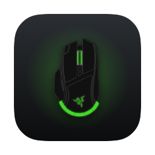
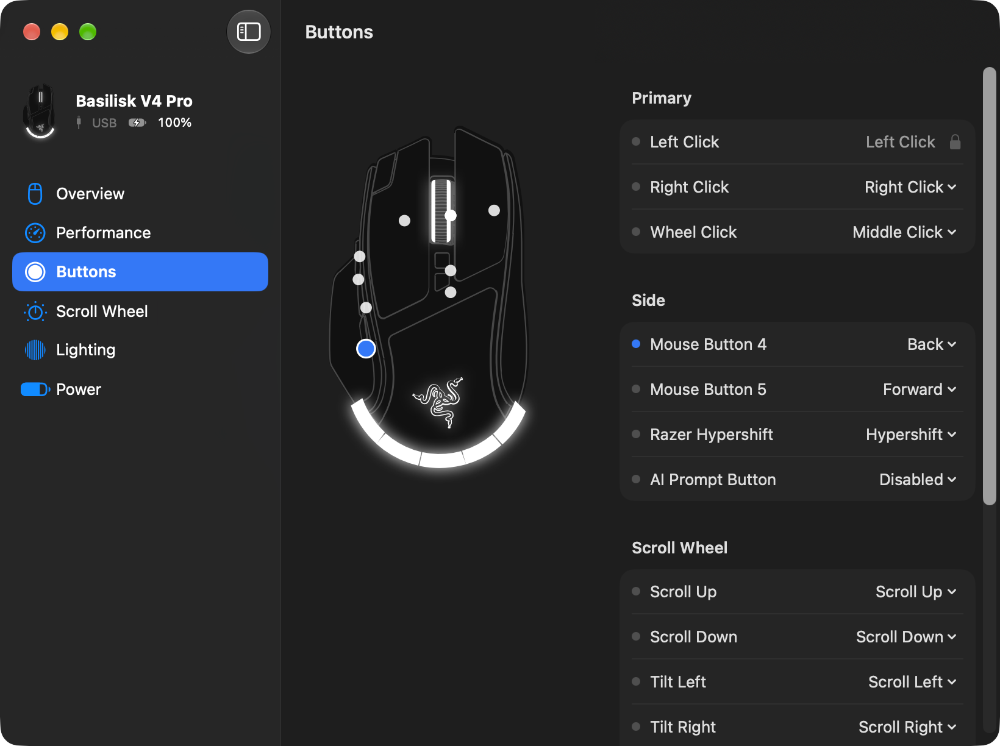

<p align="center"></p>

# Basilisk: native macOS control for the Razer Basilisk V4 Pro

Razer Synapse doesn't support the Basilisk V4 Pro on macOS. This repository contains:

1. **A native macOS app** (SwiftUI, macOS 27) that configures the mouse over USB, the HyperSpeed dongle, or Bluetooth.
2. **A full reverse-engineered spec** of the mouse: every command the firmware accepts, the packet format, all three
   transports, onboard memory, and a teardown of the firmware.

<p align="center"></p>

## The app

DPI stages (100–50,000), polling rate (125 Hz–8 kHz), lift-off distance, button remapping (including keyboard
shortcuts and DPI clutch), scroll-wheel modes, acceleration and Smart-Reel, per-zone lighting, idle dimming, sleep
timer and low-power threshold, battery in the menu bar. Settings are stored **on the mouse**, so the app doesn't need
to keep running.

It's built to be light. Discovery is hot-plug driven with no polling, there's no helper daemon or kernel extension,
and it never asks for Input Monitoring. Details: [app/README.md](app/README.md).

### Build

Requires macOS 27 and Xcode 27 (Swift 6.4).

```bash
git clone https://github.com/DhanwanthParameswar/basilisk-v4-pro-macos.git
cd basilisk-v4-pro-macos/app && ./build_app.sh
open build/Basilisk.app
```

| Connection | What works |
|---|---|
| USB cable | Everything |
| HyperSpeed dongle | Everything |
| Bluetooth | Battery, firmware info, profiles; other settings are read-only (firmware limitation) |

If a virtual machine (Parallels, VMware) has the mouse attached, the app tells you to give it back to macOS.

## The spec

| Document | Contents |
|---|---|
| [PROTOCOL.md](PROTOCOL.md) | The 90-byte HID packet, every command class, verified writes, buttons, lighting, onboard memory, firmware/updater analysis |
| [DATASHEET.md](DATASHEET.md) | All 169 command ids the firmware implements, with Synapse names, sizes and evidence |
| [TRANSPORTS.md](TRANSPORTS.md) | USB, HyperSpeed dongle (async polling) and Bluetooth LE (vendor GATT service, framing) |
| [firmware/](firmware/) | Plaintext mouse and dongle images (nRF54LM20A, Zephyr), disassembly tooling, findings |
| [captures/](captures/) | Raw evidence: Synapse device code, HID sweeps, sniffer output |
| [probe/](probe/), [tools/](tools/) | macOS HID probes, Windows VM sniffing/sweep scripts, Bluetooth probe, artwork converter |
| [assets/mouse/](assets/mouse/) | The mouse artwork extracted from Synapse (vector SVG) |

### How it was mapped

Three independent sources, cross-checked against each other:

1. Read-only HID probes run directly from macOS.
2. Razer's own per-device JavaScript, pulled from Synapse running in a Windows VM.
3. Live sniffing. The mouse echoes its last command in its feature report, so a tight read loop captures what
   Synapse sends.

The firmware image confirmed and completed the list: its command router enumerates every class and id.

### Safety

Only read commands were sent blindly; writes were limited to commands already decoded. The firmware updater was
analyzed statically, never run, and the mouse was never flashed. The app sends no DFU or bootloader commands.

## Disclaimer

An independent project, not affiliated with or endorsed by Razer. "Razer", "Basilisk", "Synapse", "HyperSpeed" and
the Razer logo are trademarks of Razer Inc. The mouse artwork, firmware images and Synapse code excerpts in this
repository are Razer's, included for interoperability research. Use at your own risk.

Original code and documentation: [MIT License](LICENSE).
